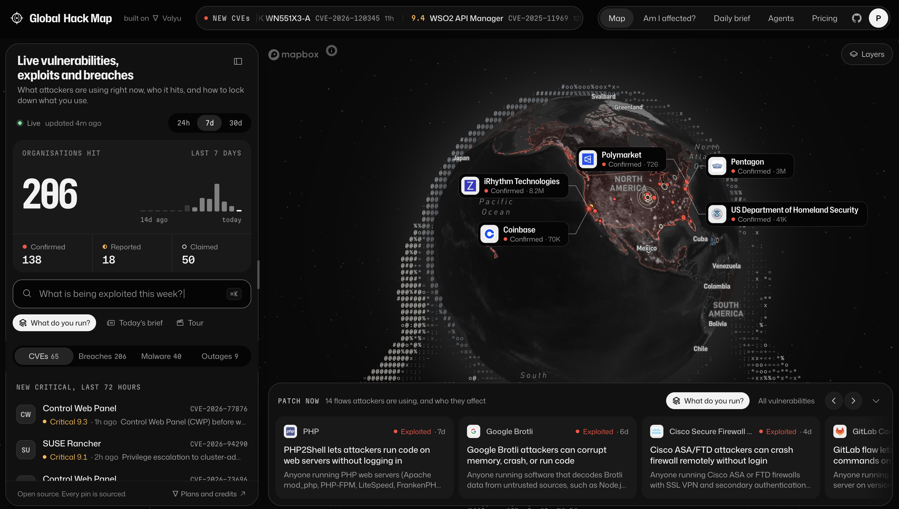

# Global Hack Map

Explore publicly reported cyber incidents, ransomware claims, exploited vulnerabilities, malicious packages and connectivity drops on one globe. Global Hack Map brings sources, incident status and remediation guidance together to help you decide what to investigate next. It is a curated, cached view, not complete coverage or a security assessment.

- **Explore the map**: browse incidents in a collapsible, resizable sidebar and open source-linked details without leaving the globe.
- **Follow vulnerabilities**: a ticker and the `/cve` index bring together recent critical CVEs and CISA's known-exploited vulnerabilities.
- **Patch now**: a collapsible dock groups remediation priorities by product, with affected software and recommended next steps.
- **Am I affected?**: select the apps, products and companies you use to find matching incidents and vulnerabilities, with optional research briefs.
- **Review remediation**: open reviewable, prefilled runbooks with CVE context and sources. Links prepare instructions; they do not automatically inspect or fix your systems.
- **Read programmatically**: a read-only MCP server, `llms.txt` and plain-text remediation runbooks at `/fix/<CVE>`.

## Status, honestly

| Status        | Means                                                       |
| ------------- | ----------------------------------------------------------- |
| Confirmed     | Acknowledged by the organisation, a regulator or a filing   |
| Reported      | Covered by the press, not yet confirmed by the organisation |
| Claimed       | Asserted by attackers on a leak site, unverified            |
| Precautionary | Systems taken offline as a precaution, no compromise stated |
| Disputed      | Reported, and denied by the organisation                    |

An absent result is never proof that you are safe. Map locations may represent a reported city, an organisation's headquarters or a country-level placement, not the exact location of a compromise. Connectivity drops alone do not establish a cyberattack.

## Run it locally

Use Node.js 22.12+ on the 22.x line, or Node.js 24.x, and pnpm 10.33.0 (pinned in `package.json`). Next.js 16.4.3 requires Node.js 20.9+, but the installed Vitest test runner requires a newer supported version.

```bash
git clone https://github.com/yorkeccak/globalhackmap.git
cd globalhackmap
pnpm install
cp .env.example .env.local
# Set NEXT_PUBLIC_MAPBOX_TOKEN in .env.local; add optional keys as needed.
pnpm dev
```

Open http://localhost:3000. A public Mapbox token is required for the globe. Public data feeds can run without a Valyu API key; Valyu news search and extraction, daily briefs, generated answers, research reports and explainers require Valyu access and may incur usage charges.

The default is self-hosted mode: no visitor accounts, with paid features using the deployment's `VALYU_API_KEY`. Keep `.env.local` private and consider usage costs before exposing a keyed deployment publicly.

For a local production build, run `pnpm build && pnpm start`. Builds can fetch upstream data and use configured paid services; duration and available data depend on those services.

### Environment

See [`.env.example`](.env.example). In short:

| Variable                                                                         | Needed for                                                                                                                                                 |
| -------------------------------------------------------------------------------- | ---------------------------------------------------------------------------------------------------------------------------------------------------------- |
| `NEXT_PUBLIC_MAPBOX_TOKEN`                                                       | The globe (a public, URL-restricted Mapbox token)                                                                                                          |
| `VALYU_API_KEY`                                                                  | News extraction, the daily brief, generated answers, research reports and explainers                                                                       |
| `CRON_SECRET`                                                                    | Authenticating the scheduled sweep and brief routes                                                                                                        |
| `GITHUB_TOKEN`                                                                   | Higher rate limits for the GitHub Advisory Database                                                                                                        |
| `NVD_API_KEY`                                                                    | Recommended: without it NVD allows 5 requests per 30s and the new-CVE feed falls back to CVE.org and CIRCL                                                 |
| `NEXT_PUBLIC_SITE_URL`                                                           | Absolute links in share cards and runbooks                                                                                                                 |
| `NEXT_PUBLIC_APP_MODE`                                                           | Optional build-time switch: `valyu` enables account mode; unset defaults to self-hosted mode                                                               |
| `NEXT_PUBLIC_VALYU_CLIENT_ID`, `NEXT_PUBLIC_REDIRECT_URI`, `VALYU_CLIENT_SECRET` | OAuth client settings for optional account mode; not needed for default self-hosting                                                                       |
| `NEXT_PUBLIC_VALYU_AUTH_URL`, `VALYU_APP_URL`                                    | Optional auth and account-platform URL overrides; default to Valyu's hosted services                                                                       |
| `SESSION_SECRET`                                                                 | Signs the anonymous brief quota cookie in account mode; falls back to `CRON_SECRET`. Production anonymous briefs in that mode require one of these secrets |

Account mode uses signed-in visitors' Valyu credits for their answers and research; shared news and anonymous answers still use the deployment key. The additional account settings above are read by the source but are not included in `.env.example`.

## Deploy

For Vercel, set the environment variables in project settings. [`vercel.json`](vercel.json) schedules the news sweep at minute 5 every six hours and the daily brief at 05:30 UTC. Set `CRON_SECRET` to authenticate those routes. Other hosts need an equivalent scheduler if those jobs are wanted.

[`next.config.ts`](next.config.ts) enables Cache Components and Partial Prefetching, with per-function cache lifetimes. Paid and rate-limited functions use `use cache: remote`. No custom remote cache handler or cache-service environment variables are configured in this repository: when self-hosting outside a platform that supplies remote caching, configure a compatible remote cache handler before relying on shared caching across instances. In-process rate limits are not a deployment-wide spending cap.

The snapshot normally revalidates after 10 minutes and public feeds after 15 minutes. These are cache policies, not publication-to-screen guarantees. Upstream delays, timeouts, cached results and fallback data can make the view older or incomplete; check timestamps and original sources.

## Development checks

```bash
pnpm exec tsc --noEmit
pnpm exec eslint src
pnpm exec vitest run
```

## How it works

- `src/lib/sources/*` fetch and normalise each feed; `src/lib/pipeline.ts` geolocates, deduplicates and scores incidents; `src/lib/snapshot.ts` assembles the cached picture the UI and the MCP server read.
- Next.js 16 with Cache Components serves prerendered shells and streams dynamic content, with per-function caching. See the caching rules in [`AGENTS.md`](AGENTS.md).
- `src/components/map/*` draws the globe with native Mapbox GL layers, the data tags and the ASCII Atlas.
- `src/lib/stack/*` parses manifests and checks them against OSV.
- `src/app/api/mcp` serves the MCP tools; `src/app/fix/[id]` renders the agent runbooks.
- Design rules live in [`DESIGN.md`](DESIGN.md).

## Data sources

| Source                                                                                               | Used for                                            | Terms                                                                                     |
| ---------------------------------------------------------------------------------------------------- | --------------------------------------------------- | ----------------------------------------------------------------------------------------- |
| [CISA Known Exploited Vulnerabilities](https://www.cisa.gov/known-exploited-vulnerabilities-catalog) | Confirmed exploitation, ransomware use              | Public domain                                                                             |
| [CVE.org](https://www.cve.org/)                                                                      | CVE records, affected products, CNA and CISA scores | [CVE Terms of Use](https://www.cve.org/Legal/TermsOfUse)                                  |
| [CIRCL Vulnerability-Lookup](https://vulnerability.circl.lu/)                                        | Recent CVE records                                  | Public service by CIRCL; CVE records under the CVE Terms of Use                           |
| [NVD](https://nvd.nist.gov/)                                                                         | Recent critical CVEs, CVSS                          | Public domain. This product uses the NVD API but is not endorsed or certified by the NVD. |
| [FIRST EPSS](https://www.first.org/epss/)                                                            | Exploitation probability                            | Free to use with attribution                                                              |
| [GitHub Advisory Database](https://github.com/advisories)                                            | Critical advisories, malicious packages             | CC BY 4.0                                                                                 |
| [OSV](https://osv.dev/)                                                                              | Package vulnerability checks                        | CC BY 4.0 (per-source terms apply)                                                        |
| [RansomLook](https://www.ransomlook.io/)                                                             | Leak-site claims                                    | CC BY 4.0                                                                                 |
| [SEC EDGAR](https://www.sec.gov/edgar)                                                               | 8-K cyber disclosures                               | Public                                                                                    |
| [IODA](https://ioda.inetintel.cc.gatech.edu/)                                                        | Country connectivity drops                          | Georgia Tech IODA                                                                         |
| [Wikidata](https://www.wikidata.org/)                                                                | Headquarters locations                              | CC0                                                                                       |
| [GeoNames](https://www.geonames.org/), [Natural Earth](https://www.naturalearthdata.com/)            | Place names and boundaries                          | CC BY 4.0, public domain                                                                  |
| [NASA Blue Marble and Black Marble](https://earthdata.nasa.gov/) via GIBS                            | Globe relief and night lights                       | Public                                                                                    |
| [Valyu](https://www.valyu.ai/)                                                                       | News search and extraction, answers, DeepResearch   | Valyu terms                                                                               |

Spotted a mistake? [Open an issue](https://github.com/yorkeccak/globalhackmap/issues/new) with a source so it can be reviewed.

## Licence

Code: MIT, see [LICENSE](LICENSE). Fonts in `src/assets/fonts` are under the SIL Open Font License.
